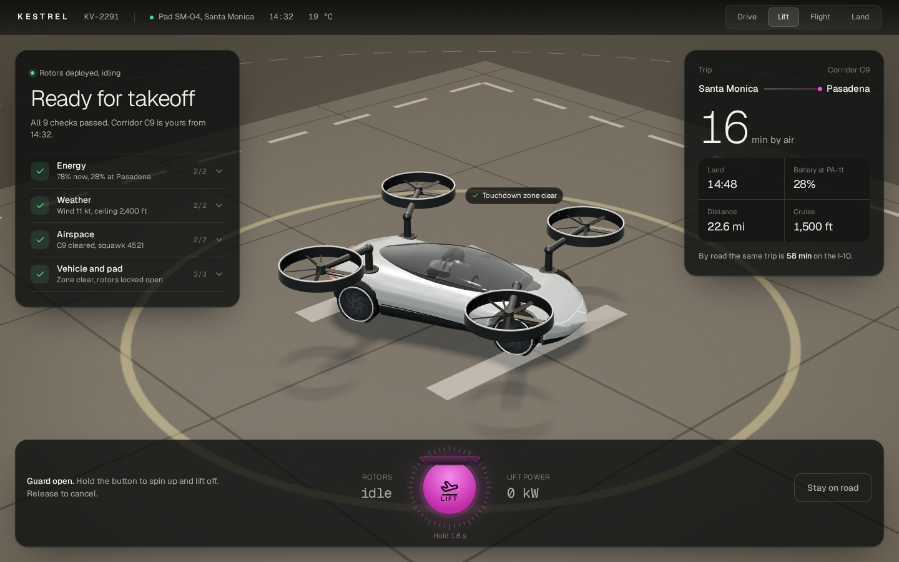
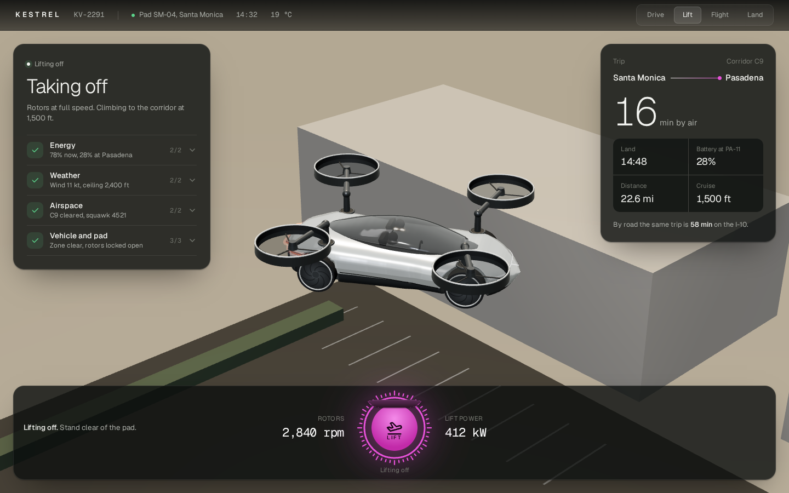
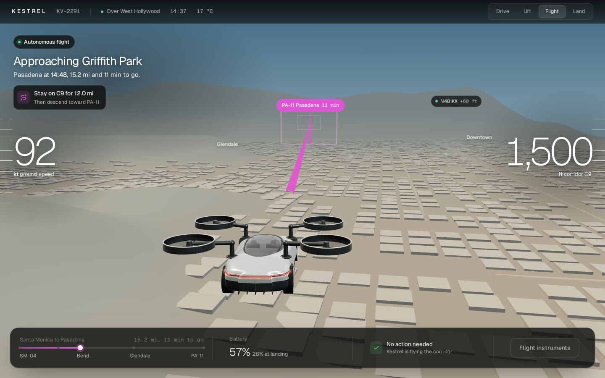
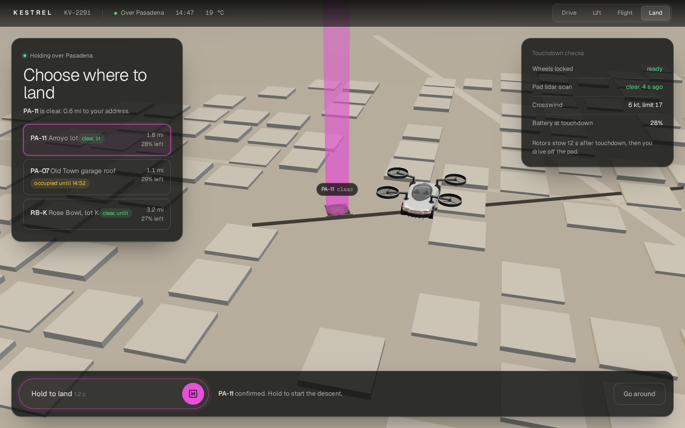
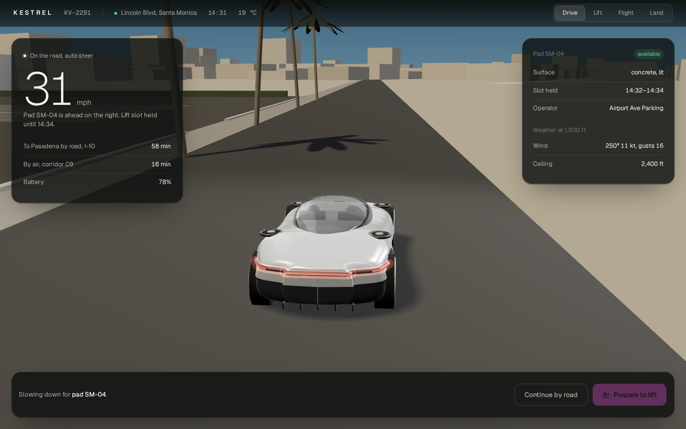
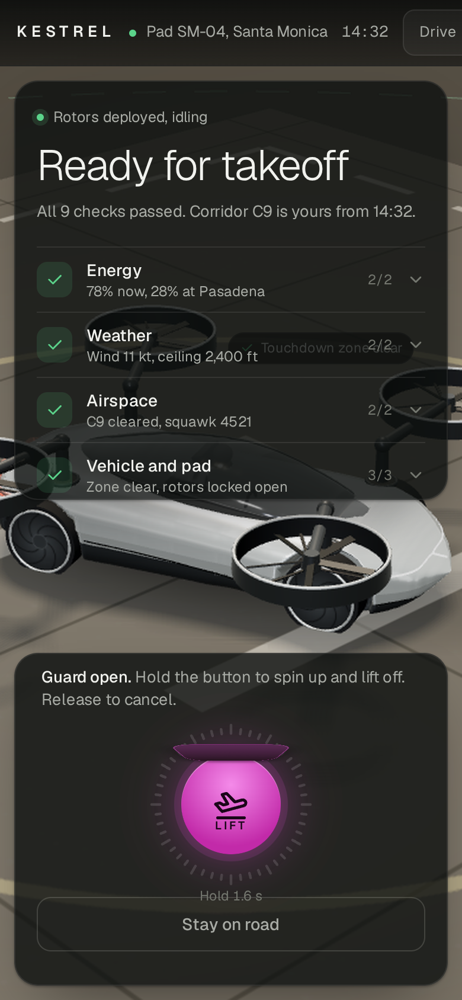

# Kestrel — Cockpit display for a roadable eVTOL

**Live demo:** https://maveriqq.github.io/shots/2026-10-kestrel/

## The problem
Flying cars are close: several companies are building vehicles that drive on the road and take off as eVTOLs. The hard part is not the flight itself but the switch from car to aircraft. Before lift-off nine things have to be right across four systems — battery reserve, weather, an airspace corridor, the pad and the rotors — and the person in the seat is a driver, not a pilot.

## The idea
Kestrel Cockpit turns that switch into one calm sequence. The car parks on a pad, runs its own pre-flight, unfolds its rotors and opens a guarded ignition. Hold the button, the rotors spin up in sync, and the car lifts off into an autonomous flight over Los Angeles.

## Key decisions
- **Nine checks, four groups** — Energy, Weather, Airspace, Vehicle and pad. Green groups stay folded; only a problem would open and explain itself.
- **A guarded ignition instead of a button** — the cover stays locked until every check is green. Holding for 1.6 s spins the rotors up in the 3D scene; releasing early cancels everything.
- **One continuous world** — drive, lift, flight and landing happen in the same scene. The camera rises with the car as the pad drops away, then settles behind it.
- **Autonomous by default** — in flight the screen answers where, when, how much battery and whether you are needed. Pilot instruments are a second layer.
- **The decision comes back where it matters** — approaching Pasadena, Kestrel holds until you confirm a pad; an occupied pad locks the descent.

## The result
A 22.6 mile trip from Santa Monica to Pasadena in 16 minutes instead of 58 on the I-10, with one hold of a button and one confirmation.

## Screens

## Demo keys
`R` restart · `1` Drive · `2` Lift · `3` Flight · `4` Land · `F` film mode (a fixed 20 s take for recording, `Esc` to stop)

## Details
Archetype: industry precision, 3D product scene · Fonts: Geist, Geist Mono · Icons: Tabler Icons · 3D: three.js r128, vehicle built in code from orthographic concept views · Palette: #0C0D0C · #E651D8 · #5BD38A · #F0C24B · #A3A6A4

Concept shot by Vitalii. Product, names and data are fictional.
