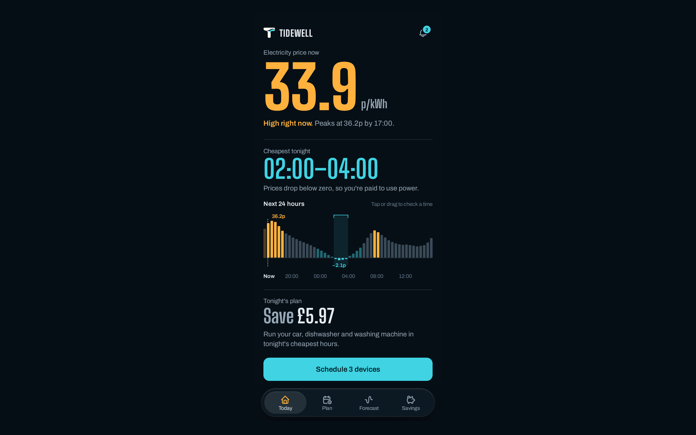
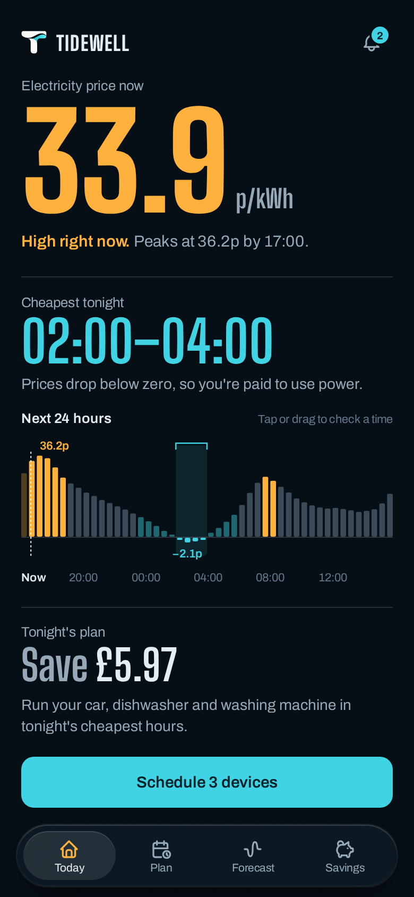
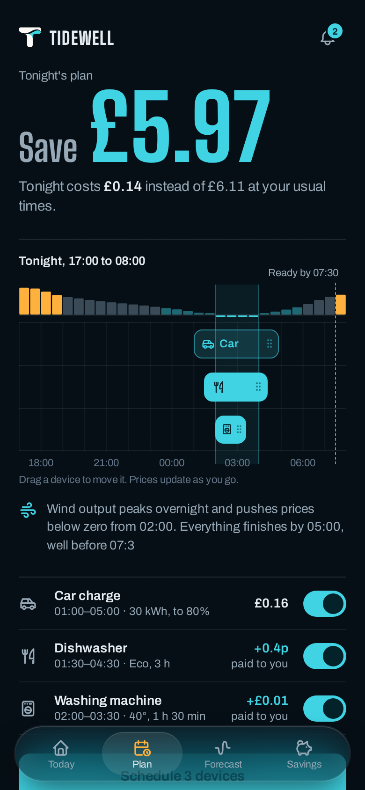
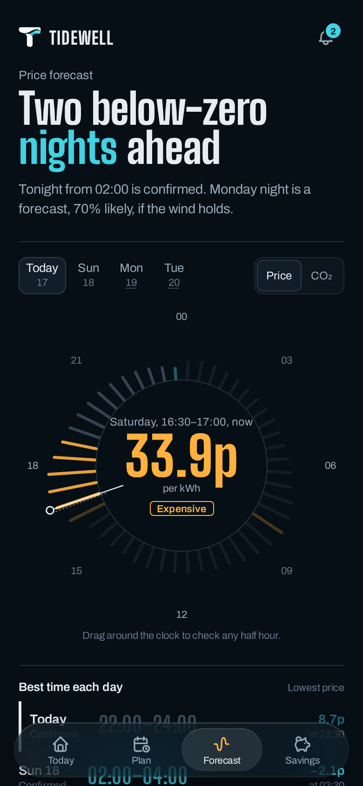
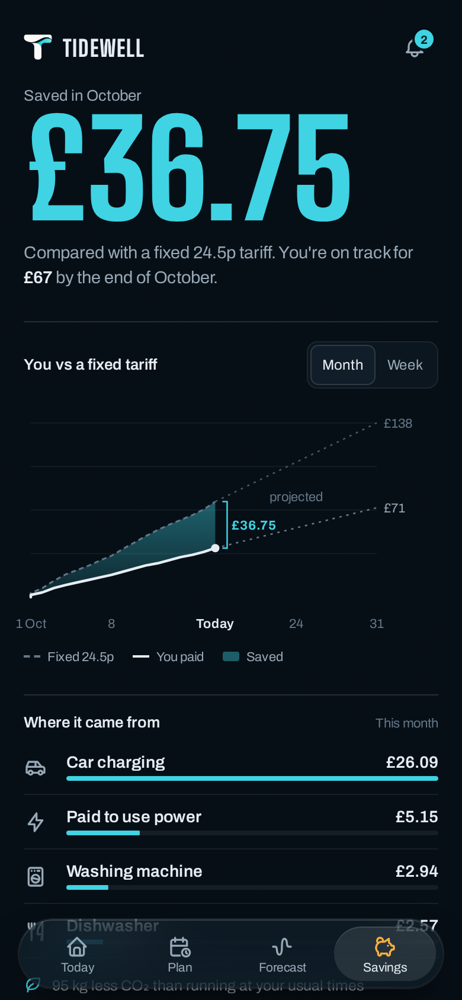
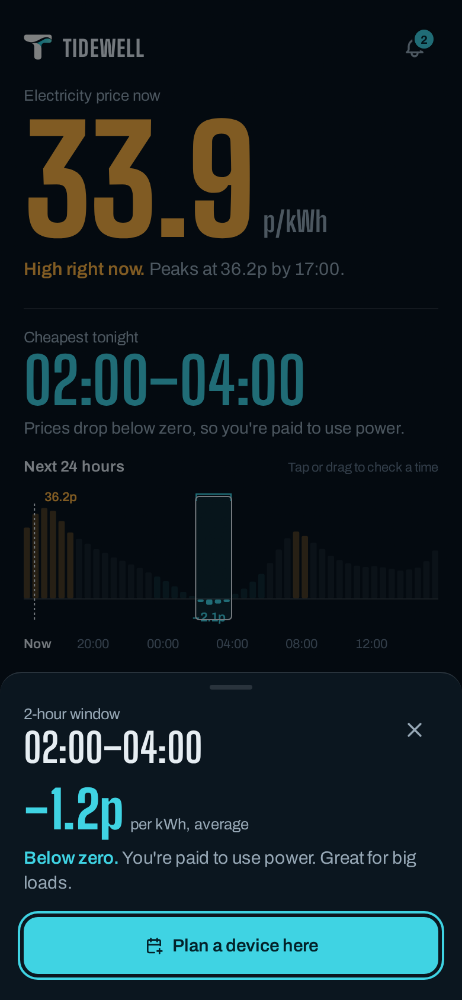

# Tidewell — Mobile app for home energy

**Live demo:** https://maveriqq.github.io/shots/2026-10-tidewell/

## The problem
Households on dynamic electricity tariffs get 48 prices a day, sometimes below zero, and the price changes every half hour. Owners on Reddit and energy forums describe stitching together price apps, IFTTT rules and smart plugs just to run the dishwasher at the right time. The savings are real, but living by a price chart is not.

## The idea
Tidewell turns the day into a tide of prices and lays your car, dishwasher and washing machine onto its lowest point, with a plain reason for each move. You can drag any device to another time and see the cost change live.

## Key decisions
- **One number first** — Today opens with the price right now and tonight’s cheapest window, so the app answers “should I wait?” in a glance.
- **Devices that travel** — on Plan, each device slides from its usual evening slot to the below-zero night window; the saving counts up as they land. Dragging re-plans with live cost and a ready-by time.
- **A clock, not a table** — Forecast shows the next day as a 24-hour dial with confidence for nights that aren’t confirmed yet.
- **Savings you can trust** — the month is compared with a fixed 24.5p tariff, split by device.

## The result
The user schedules three devices in one tap, gets paid to charge the car on negative-price nights, and stops checking prices.

## Screens

## Demo keys
`R` replay the screen’s animation · `1` Today · `2` Plan · `3` Forecast · `4` Savings · `5` cheapest window

## Details
Archetype: AI planner, mobile · Fonts: Big Shoulders Display + Archivo · Icons: Tabler · Palette: #060E15 · #FFB13D · #3FD3E3 · #3A4A57
Concept shot by Vitalii. Product, names and data are fictional.
